# Knox Avellaneda · Foro de un Servidor de Project Zomboid

Red social desarrollada para el **TP #2 de Programación IV**. Simula ser el **foro de la comunidad de un servidor (ficticio) de Project Zomboid**, ambientado en Avellaneda: el staff publica parches, eventos y avisos de mantenimiento, y los jugadores ("supervivientes") comentan y opinan.

Los usuarios publican con imagen opcional, dan "me gusta", comentan y editan sus comentarios, y administran su perfil. Los administradores tienen un panel para gestionar usuarios (alta, baja y alta lógica), ver estadísticas con gráficos y anunciar el inicio y el fin del mantenimiento del servidor. La aplicación está dividida en dos proyectos: un **frontend en Angular** y un **backend en NestJS** con **MongoDB**. La autenticación usa **JWT**.

> La IP del servidor que se muestra en la página (`203.0.113.47:16261`) es **ficticia**: pertenece a un rango reservado para ejemplos (RFC 5737) y no apunta a ningún servidor real.

- **Frontend en producción:** [URL_DEL_FRONT](URL_DEL_FRONT) <!-- TODO: completar con la URL de Vercel del front -->
- **Backend en producción:** [https://backend-sandy-chi-84.vercel.app](https://backend-sandy-chi-84.vercel.app)
- **Frontend:** Angular 22 (Standalone Components, Signals, PWA)
- **Backend:** NestJS 12 + Mongoose 9 sobre MongoDB Atlas
- **Imágenes:** Cloudinary
- **Hosting:** Vercel (front y back por separado)

---

## Capturas de Pantalla

### 1. Inicio de Sesión y Registro (`/login` y `/registro`)
Formularios reactivos con validaciones y mensajes en cada campo. El login acepta correo o nombre de usuario y muestra la **ficha del servidor** (nombre, IP ficticia y estado). La contraseña pide al menos 8 caracteres, una mayúscula y un número. El registro incluye foto de perfil con vista previa y fecha de nacimiento con validación de edad mínima. Si el login falla, **tiembla toda la pantalla y suena un "bzzz"** como el zumbido del MSN (directiva `zumbido`), y el mensaje se arma según el tipo de error (pipe `errorLogin`). Si un administrador deshabilitó la cuenta, el mensaje es *"💀 Así es como moriste. Fuiste baneado del servidor por el staff."*
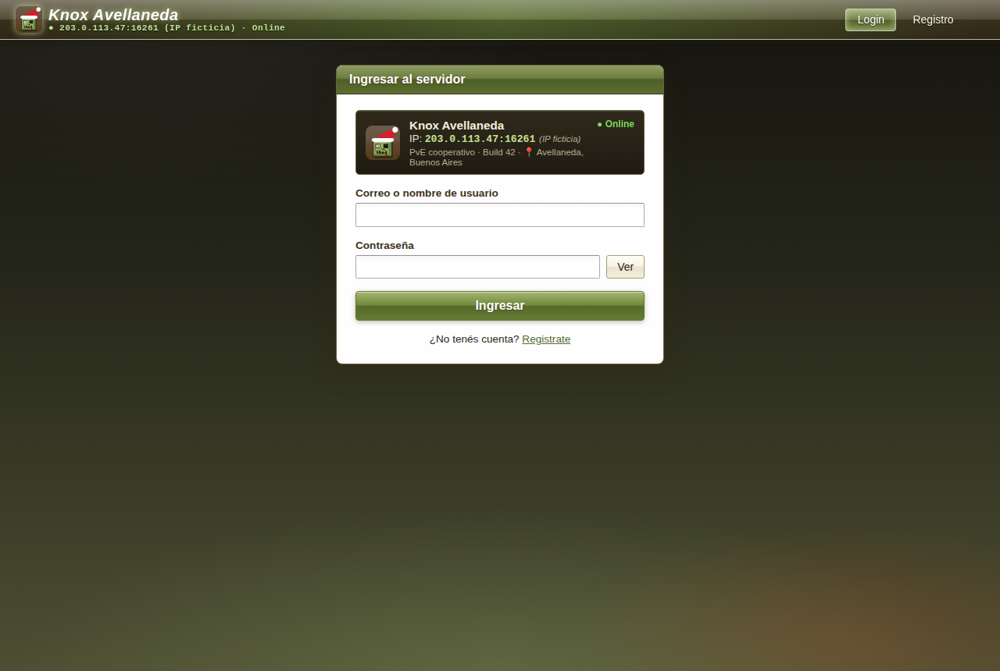
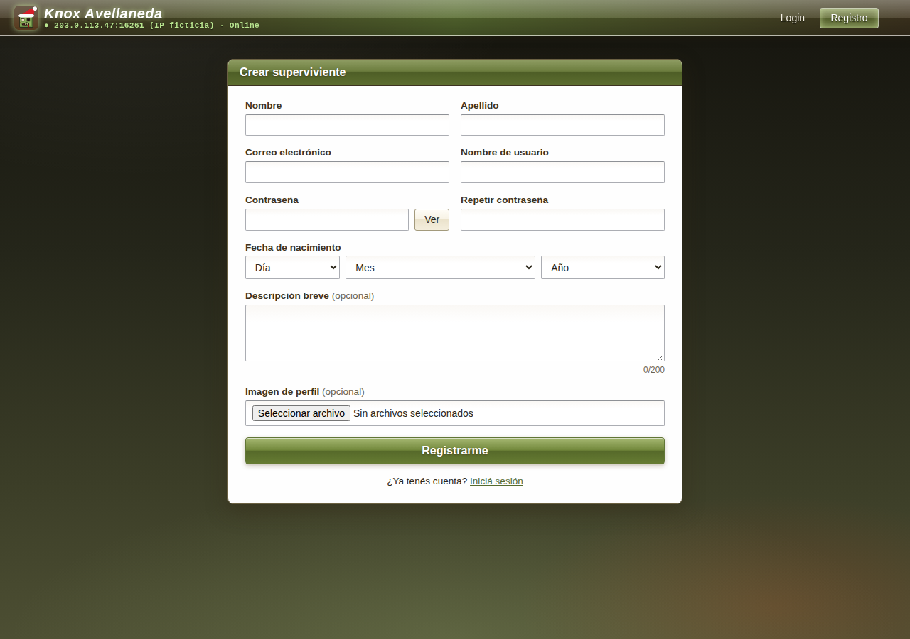

---

### 2. Pantalla de Carga (`/cargando`)
Al iniciar la aplicación se muestra un spinner ("Sintonizando la frecuencia del servidor...") mientras se valida el token guardado contra `POST /auth/autorizar`. Si es válido, redirige a publicaciones; si no, al login.
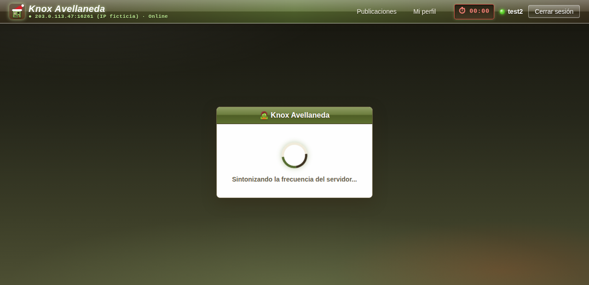

---

### 3. Publicaciones (`/publicaciones`)
Listado paginado con orden por fecha o por cantidad de "me gusta" (ascendente o descendente). Cada publicación es un componente con:
- Botón de me gusta, que se puede dar y quitar.
- Vista previa de los últimos 3 comentarios, con aviso de "N comentarios más · Ver hilo completo".
- Botón para eliminar, visible para el autor o un administrador.

**Comunicados del staff:** si el autor es administrador, la directiva `anuncioOficial` convierte la tarjeta en un comunicado oficial: cinta con franjas de peligro, borde mostaza y texto a máquina de escribir. La cinta se elige según el título: 🔧 *Notas del parche*, 🚁 *Evento del servidor*, ⚠️ *Aviso de mantenimiento*, ✅ *Servidor en línea* o 📢 *Comunicado oficial*. Las publicaciones de los usuarios comunes mantienen el estilo normal.

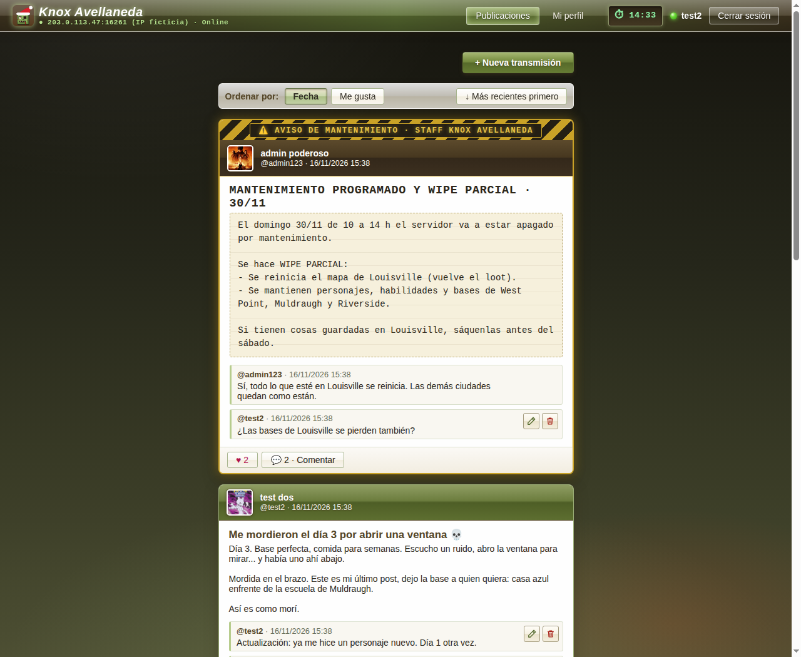

---

### 4. Página de Publicación (`/publicacion/:id`)
La publicación en grande con todos sus comentarios, del más reciente al más antiguo. Llegan de a 5, y el botón **"Cargar más"** suma los siguientes sin borrar los anteriores. Se puede escribir comentarios. El autor puede editar el suyo (✎), que queda marcado como *(editado)*. El autor o un administrador pueden eliminarlo (🗑).
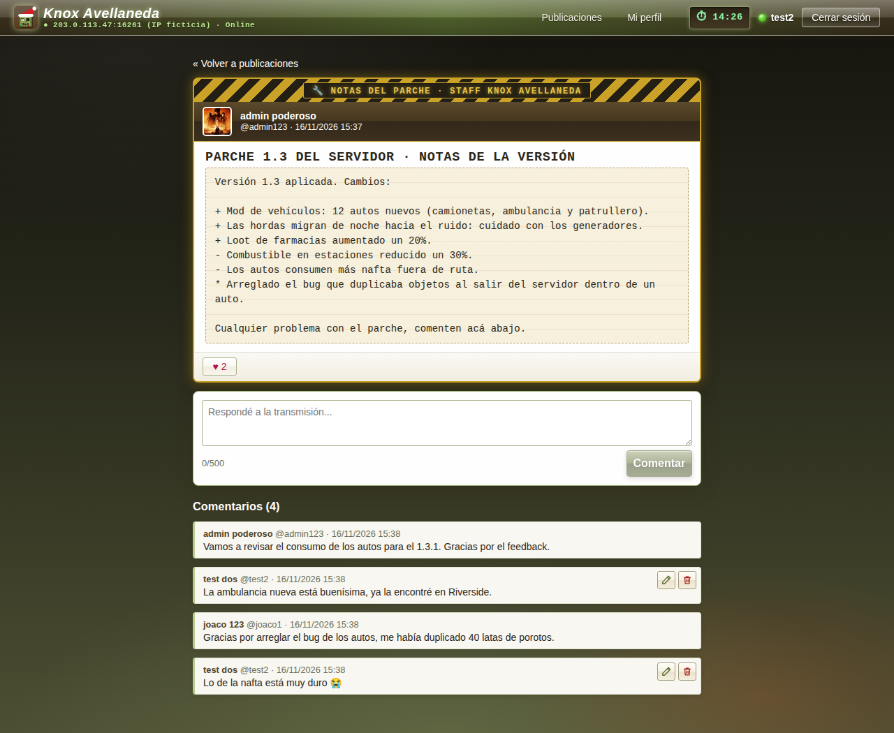

---

### 5. Mi Perfil (`/mi-perfil`)
Datos del usuario, foto de perfil (se puede cambiar) y las últimas 3 publicaciones con sus comentarios.
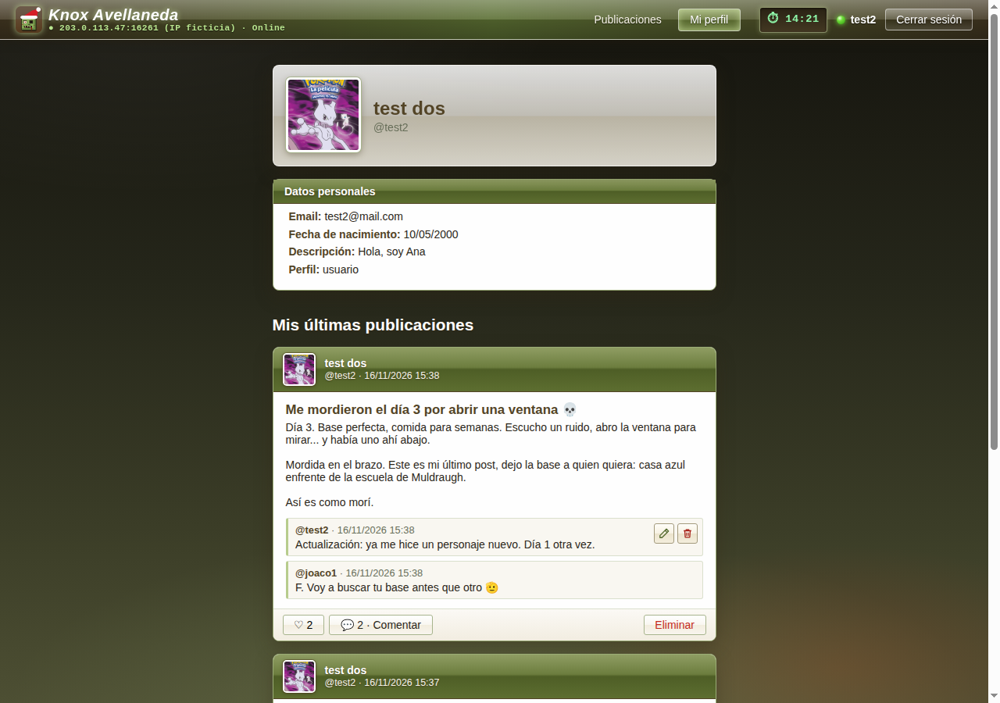

---

### 6. Sesión con Vencimiento
El token vence a los 15 minutos. El reloj del navbar muestra el tiempo restante (pipe `tiempoRestante`). A los 10 minutos aparece un modal que avisa que quedan 5 minutos y ofrece extender la sesión, lo que refresca el token con `POST /auth/refrescar`. Si una petición devuelve 401, se redirige al login.
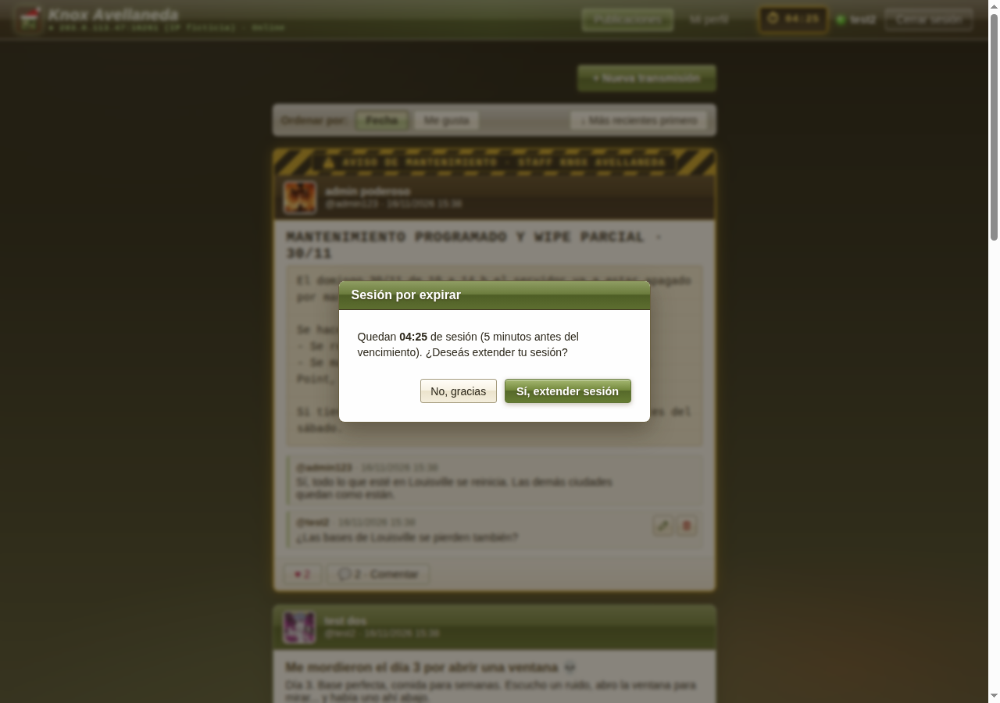

---

### 7. Panel de Administración (`/dashboard`)
Solo para usuarios con perfil **administrador**. Se accede desde **"Panel"** en el navbar y tiene tres pestañas.

<table>
  <tr>
    <td width="50%">
      <b>Usuarios</b> (<code>/dashboard/usuarios</code>) · Listado con perfil y estado, alta de usuarios con el mismo formulario del registro y radio buttons para elegir <i>usuario</i> o <i>administrador</i>, y deshabilitación y habilitación (baja y alta lógica). Un usuario deshabilitado no puede ingresar y se le avisa al intentar el login.<br><br>
      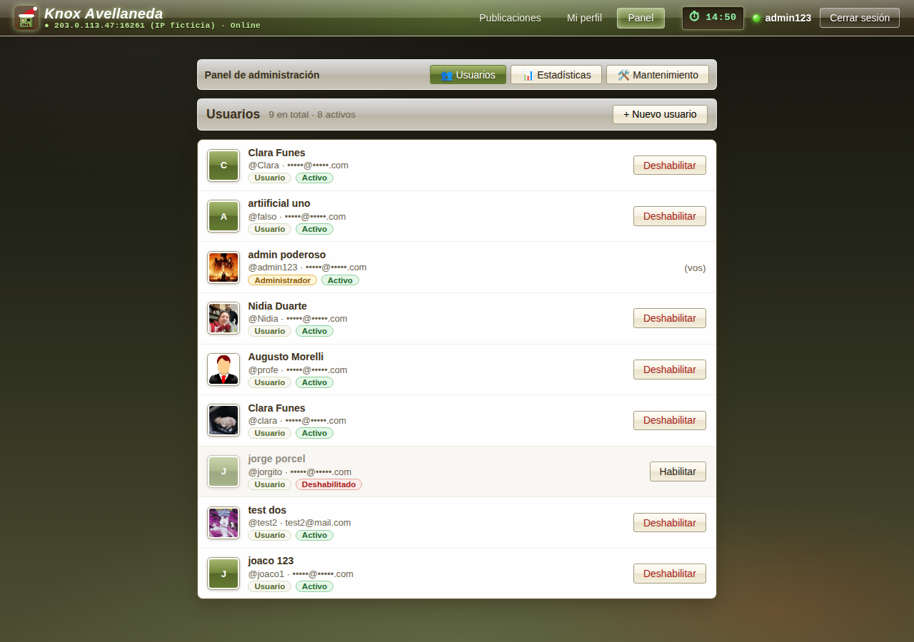
    </td>
    <td width="50%">
      <b>Estadísticas</b> (<code>/dashboard/estadisticas</code>) · Gráficos de distinto tipo hechos con Chart.js, cada uno con su propio lapso de tiempo (desde / hasta):<br>
      🥧 Publicaciones por usuario (torta)<br>
      📈 Comentarios por día (líneas)<br>
      📊 Comentarios por publicación (barras horizontales)<br>
      👥 Usuarios registrados por día (barras)<br><br>
      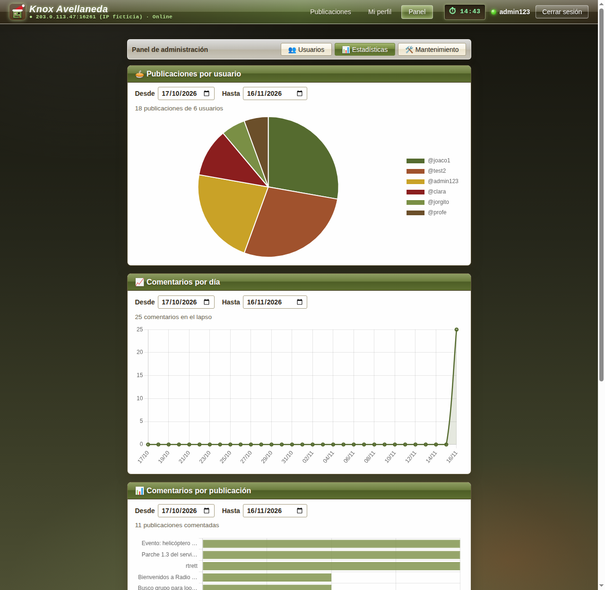
    </td>
  </tr>
</table>

---

### 8. Mantenimiento del Servidor (`/dashboard/mantenimiento`)
Pestaña del panel con dos botones: **🛠️ Iniciar mantenimiento** y **✅ Finalizar mantenimiento**. Cada uno publica en el foro un comunicado del staff (con un detalle opcional: motivo, duración o cambios), después de confirmarlo en un modal con la vista previa. Sólo está habilitado el botón que corresponde al estado actual.

El estado del servidor se deduce del último comunicado de mantenimiento publicado por un administrador (`GET /servidor/estado`, pública). Mientras dura el mantenimiento, **el navbar y la ficha del login pasan a amarillo y "Offline"** (directiva `luzServidor` + pipe `estadoServidor`). El front consulta el estado al cargar, cada 30 segundos y apenas el admin publica.

<table>
  <tr>
    <td width="50%">
      <b>Panel de mantenimiento</b> · servidor online<br><br>
      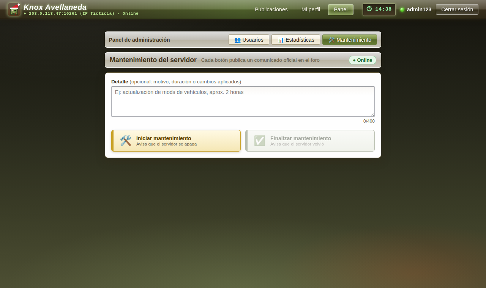
    </td>
    <td width="50%">
      <b>Login durante el mantenimiento</b> · servidor offline<br><br>
      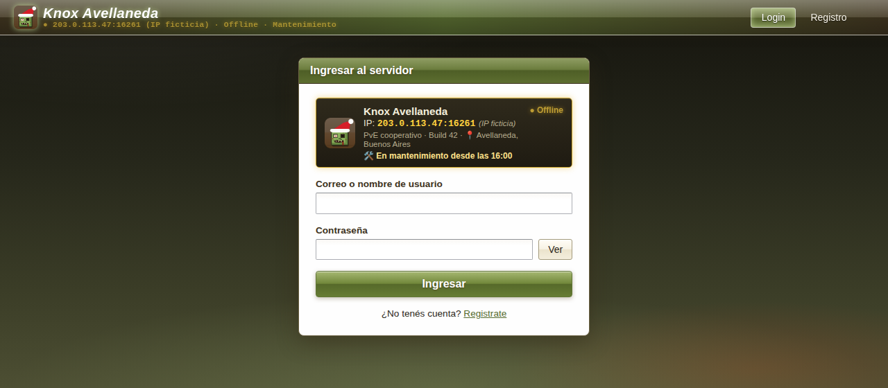
    </td>
  </tr>
</table>

---

## Tecnologías Utilizadas

| Capa / Área | Tecnología | Propósito en el Sistema |
| :--- | :--- | :--- |
| **Frontend Framework** | **Angular 22** | SPA con componentes Standalone, control flow nativo (`@if`, `@for`) y rutas protegidas con guards funcionales. |
| **Gestión de Estado** | **Angular Signals** | Reactividad con `signal()`, `computed()`, `linkedSignal()` y `effect()`. |
| **Formularios** | **Reactive Forms** | Validadores propios (contraseña fuerte, coincidencia de contraseñas, fecha de nacimiento, archivo de imagen). |
| **Gráficos** | **Chart.js 4** | Gráficos de torta, líneas y barras del panel de estadísticas. Se carga de forma diferida (lazy) para no agrandar el bundle inicial. |
| **PWA** | **@angular/service-worker** | Aplicación instalable con manifest e íconos propios, y caché del código de la app. |
| **Backend Framework** | **NestJS 12** | Módulos de Autenticación, Usuarios y Publicaciones, con controllers de publicaciones, comentarios, estadísticas y estado del servidor. |
| **Base de Datos** | **MongoDB Atlas + Mongoose 9** | Colecciones de usuarios, publicaciones y comentarios. Las estadísticas se calculan con `aggregate`. |
| **Autenticación** | **JWT (`@nestjs/jwt`)** | El token lleva el id, el correo, el nombre de usuario y el rol, y vence a los 15 minutos. Hay rutas para autorizar y refrescar. |
| **Contraseñas** | **scrypt (`@nestjs/authentication`)** | Las contraseñas se guardan encriptadas. |
| **Validación** | **class-validator + ValidationPipe** | DTOs con mensajes de error en español y status HTTP correctos (400, 401, 403, 404, 409). |
| **Imágenes** | **Cloudinary** | Fotos de perfil e imágenes de publicaciones. El front las comprime antes de subirlas. |
| **Lenguaje** | **TypeScript 6** | Tipado en modelos, DTOs y servicios. |
| **Hosting** | **Vercel** | Front y back desplegados como proyectos separados. |

---

## Requisitos de Angular Propios

| Tipo | Nombre | Qué hace | Dónde se usa |
| :--- | :--- | :--- | :--- |
| Pipe | `tiempoRestante` | Convierte segundos en formato reloj `MM:SS`. | Reloj de sesión del navbar. |
| Pipe | `errorLogin` | Convierte el error del login en un mensaje según el status (🔑 credenciales, 💀 cuenta baneada, 📡 sin conexión…). | Login. |
| Pipe | `estadoServidor` | Convierte el estado del servidor en texto: `Online`, `Offline · Mantenimiento` o `En mantenimiento desde las 15:55`. | Navbar, login y pestaña Mantenimiento del panel. |
| Directiva | `zumbido` | Hace temblar la pantalla y suena un "bzzz" como el zumbido del MSN cada vez que cambia el valor que recibe. | Formulario de login cuando falla. |
| Directiva | `anuncioOficial` | Si el autor de la publicación es administrador, la convierte en un comunicado del staff: cinta con franjas de peligro, borde mostaza y texto a máquina. Elige la cinta según el título (🔧 parche, 🚁 evento, ⚠️ mantenimiento, ✅ servidor en línea, 📢 comunicado). | Tarjeta de publicación. |
| Directiva | `luzServidor` | Agrega las clases `luz-online` / `luz-offline` para pintar el estado del servidor de verde (online) o amarillo (en mantenimiento), y un texto al pasar el mouse. | Navbar, login y pestaña Mantenimiento del panel. |

---

## Endpoints del Backend

Las rutas marcadas con 🔒 requieren token (`Authorization: Bearer <token>`). Las marcadas con 👑 requieren además perfil administrador.

| Método | Ruta | Descripción |
| :--- | :--- | :--- |
| `POST` | `/auth/registro` | Registro (multipart/form-data con foto opcional). Devuelve el token y el usuario. |
| `POST` | `/auth/login` | Login con correo o nombre de usuario. 401 si los datos son incorrectos, 403 si el usuario está deshabilitado. |
| `POST` | `/auth/autorizar` 🔒 | Valida el token y devuelve los datos del usuario. |
| `POST` | `/auth/refrescar` 🔒 | Devuelve un token nuevo con la misma payload y 15 minutos más. |
| `GET` | `/publicaciones` 🔒 | Listado con `orden` (fecha / meGusta), `direccion`, `usuario`, `offset` y `limit`. |
| `GET` | `/publicaciones/:id` 🔒 | Una publicación. |
| `POST` | `/publicaciones` 🔒 | Alta (título, descripción e imagen opcional). |
| `DELETE` | `/publicaciones/:id` 🔒 | Baja lógica (autor o administrador). |
| `POST` / `DELETE` | `/publicaciones/:id/me-gusta` 🔒 | Dar / quitar me gusta (uno por usuario). |
| `GET` | `/publicaciones/:id/comentarios` 🔒 | Comentarios paginados, los más recientes primero. |
| `POST` | `/publicaciones/:id/comentarios` 🔒 | Agregar un comentario. |
| `PUT` | `/publicaciones/:id/comentarios/:comentarioId` 🔒 | Editar el comentario propio (queda `modificado: true`). |
| `DELETE` | `/publicaciones/:id/comentarios/:comentarioId` 🔒 | Baja lógica (autor o administrador). |
| `PATCH` | `/usuarios/foto` 🔒 | Cambiar la foto de perfil propia. |
| `GET` | `/usuarios` 👑 | Listado de usuarios. |
| `POST` | `/usuarios` 👑 | Alta de usuario eligiendo el perfil. |
| `DELETE` | `/usuarios/:id` 👑 | Deshabilitar (baja lógica). |
| `POST` | `/usuarios/:id/habilitar` 👑 | Rehabilitar (alta lógica). |
| `GET` | `/estadisticas/publicaciones-por-usuario` 👑 | Con `desde` / `hasta` (YYYY-MM-DD). |
| `GET` | `/estadisticas/comentarios` 👑 | Comentarios por día en el lapso. |
| `GET` | `/estadisticas/comentarios-por-publicacion` 👑 | Comentarios de cada publicación en el lapso. |
| `GET` | `/estadisticas/usuarios` 👑 | Usuarios registrados por día en el lapso. |
| `GET` | `/servidor/estado` | **Pública.** `{ online, desde }`: si el servidor está en mantenimiento, según el último comunicado de mantenimiento de un administrador. |

---

## Correr Localmente

### 1. Backend (NestJS)

1. **Ingresar a la carpeta e instalar dependencias:**
   ```bash
   cd backend
   npm install
   ```

2. **Crear el archivo `.env`** en `backend/` con estas variables:
   ```env
   PORT=3000

   # Connection string de MongoDB Atlas
   MONGODB_URI=

   # JWT
   JWT_SECRET=un_texto_largo_y_aleatorio
   JWT_EXPIRES_IN=15m

   # Cloudinary (imágenes)
   CLOUDINARY_CLOUD_NAME=
   CLOUDINARY_API_KEY=
   CLOUDINARY_API_SECRET=

   # URL del front permitida por CORS (varias separadas por coma)
   FRONTEND_URL=http://localhost:4200
   ```

3. **Iniciar el servidor en modo desarrollo:**
   ```bash
   npm run start:dev
   ```
   Queda escuchando en `http://localhost:3000`.

### 2. Frontend (Angular)

1. **Ingresar a la carpeta e instalar dependencias:**
   ```bash
   cd frontend
   npm install
   ```

2. **Iniciar el servidor local:**
   ```bash
   ng serve
   ```
   *(También se puede usar `npm start`)*

3. **Abrir en el navegador:**
   ```text
   http://localhost:4200
   ```

En desarrollo, el front apunta al back local (`src/environments/environment.development.ts`). En producción apunta al back de Vercel (`src/environments/environment.ts`). El service worker de la PWA solo se activa en el build de producción.

---

### Cuentas de Prueba

| Rol | Correo / Usuario | Contraseña | Acceso |
| :--- | :--- | :--- | :--- |
| **Administrador** | `COMPLETAR` | `COMPLETAR` | Todo lo del usuario, más el **Panel** (usuarios, estadísticas y mantenimiento), sus publicaciones se ven como comunicados del staff, y puede dar de baja cualquier publicación o comentario. |
| **Usuario** | `test2@mail.com` | `Clave123` | Publicar, dar me gusta, comentar, editar sus comentarios y su perfil. |

Para convertir una cuenta en administrador por primera vez, hay que cambiar en MongoDB el campo `perfil` del usuario a `"administrador"` y volver a iniciar sesión. Después, un administrador puede crear otros desde el panel.

---

## Cómo Actualizar el Deploy en Vercel

El front y el back son **dos proyectos separados en Vercel**, conectados al repositorio. Cada `git push` a `main` genera un deploy nuevo de los dos.

```bash
git add .
git commit -m "descripción del cambio"
git push
```

**Variables de entorno del back en Vercel** (Project → Settings → Environment Variables): las mismas del `.env`, con `FRONTEND_URL` apuntando a la URL del front de Vercel (sin `/` al final).

Para verificar el build del front antes de pushear:
```bash
cd frontend
npx ng build
```

Si después de un deploy se sigue viendo la versión anterior, es la caché del service worker de la PWA. Se arregla recargando la página dos veces, o desde DevTools → Application → Service Workers → *Unregister*.

---

## Estructura del Código Fuente

```text
tp2redProg4/
├── backend/                        # API en NestJS
│   └── src/
│       ├── archivos/               # Subida de imágenes a Cloudinary
│       ├── auth/                   # Registro, login, autorizar y refrescar (JWT)
│       ├── config/                 # Orígenes permitidos por CORS
│       ├── guards/
│       │   ├── auth/               # AuthGuard: valida el JWT
│       │   └── admin/              # AdminGuard: exige perfil administrador
│       ├── publicaciones/          # Publicaciones, comentarios, estadísticas y estado del servidor
│       │   ├── dto/
│       │   └── entities/           # Publicacion y Comentario (Mongoose)
│       ├── usuarios/               # Usuarios: foto de perfil y ABM del administrador
│       └── main.ts                 # ValidationPipe global y CORS
├── frontend/                       # SPA en Angular
│   ├── public/                     # Favicon, logo (zombie), íconos y manifest de la PWA
│   └── src/app/
│       ├── cargando/               # Pantalla de carga (valida el token)
│       ├── login/ registro/        # Autenticación (registro reutilizado por el admin)
│       ├── publicaciones/          # Listado con orden y paginación
│       ├── publicacion/            # Tarjeta de publicación (componente)
│       ├── pagina-publicacion/     # Publicación en grande + hilo de comentarios
│       ├── comentario-item/        # Un comentario (editar / eliminar)
│       ├── nueva-publicacion/      # Formulario para publicar
│       ├── mi-perfil/              # Perfil del usuario
│       ├── panel/                  # Panel de administración (pestañas)
│       ├── dashboard-usuarios/     # ABM de usuarios
│       ├── dashboard-estadisticas/ # Gráficos con Chart.js
│       ├── dashboard-mantenimiento/ # Anunciar inicio / fin del mantenimiento
│       ├── grafico/                # Componente que envuelve Chart.js
│       ├── navbar/                 # Navegación, estado del servidor y reloj de sesión
│       ├── directivas/             # Directivas propias (zumbido, anuncioOficial, luzServidor)
│       ├── pipes/                  # Pipes propios (tiempoRestante, errorLogin, estadoServidor)
│       ├── guards/                 # authGuard y adminGuard
│       ├── interceptores/          # Agrega el token y maneja los 401
│       ├── servicios/              # Comunicación con la API (y estado del servidor)
│       ├── modelos/                # Interfaces (usuario, publicación, comentario)
│       ├── validadores/            # Validadores de formularios reutilizables
│       └── servidor.ts             # Datos del servidor ficticio (nombre, IP, puerto)
└── docs/
    └── screenshots/                # Capturas de pantalla de la aplicación
```
